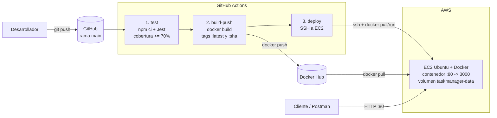

# API de Gestión de Tareas — Pipeline CI/CD con Docker, GitHub Actions y AWS EC2

API REST construida con **Node.js + Express + SQLite**, con pruebas automatizadas (**Jest + Supertest**),
contenedorizada con **Docker** y desplegada de forma continua en **AWS EC2** mediante **GitHub Actions**.

Cada `git push` a `main` ejecuta las pruebas, publica una imagen nueva en **Docker Hub** y actualiza el
servidor automáticamente, sin entrar a la instancia.

---

## 1. Arquitectura



| Componente | Tecnología | Función |
|---|---|---|
| API | Node.js 22, Express 4 | Endpoints REST con respuesta normalizada `{ statusCode, data }` |
| Base de datos | SQLite (better-sqlite3) | Tablas `categorias` y `tareas` (llave foránea) |
| Pruebas | Jest 29 + Supertest 7 | 105 pruebas, BD en memoria, umbral de cobertura del 70% |
| Contenedor | Docker (multi-etapa, `node:22-slim`) | Imagen ligera, usuario sin privilegios, `HEALTHCHECK` |
| Registro | Docker Hub | Tags `:latest` y `:<hash-del-commit>` |
| CI/CD | GitHub Actions | `.github/workflows/main.yml` |
| Servidor | AWS EC2 (Ubuntu Server) | Ejecuta el contenedor en el puerto 80 |

---

## 2. Endpoints

| Método | Ruta | Descripción |
|---|---|---|
| GET | `/` | Mensaje de bienvenida y versión |
| GET | `/api/health` | Estado del servicio, versión, **commit desplegado** y estado de la BD |
| GET | `/api/tareas` | Listar tareas (filtro opcional `?completada=0\|1`) |
| GET | `/api/tareas/:id` | Obtener una tarea |
| POST | `/api/tareas` | Crear tarea — body: `{"titulo":"...","categoria_id":1}` |
| PUT | `/api/tareas/:id` | Actualizar `titulo`, `completada` y/o `categoria_id` |
| PATCH | `/api/tareas/:id/completar` | Marcar tarea como completada |
| DELETE | `/api/tareas/:id` | Eliminar tarea |
| GET | `/api/categorias` | Listar categorías |
| GET | `/api/categorias/:id` | Obtener una categoría |
| POST | `/api/categorias` | Crear categoría — body: `{"nombre":"..."}` |
| PUT | `/api/categorias/:id` | Renombrar categoría |
| DELETE | `/api/categorias/:id` | Eliminar categoría |
| GET | `/api/backup` | Descargar respaldo JSON de la BD |
| DELETE | `/api/reset` | Vaciar la BD (requiere header `x-confirm-reset: true`) |

Además, un servidor de **sockets TCP** en el puerto `6061` acepta `{insert:<json>}` y `{get:<id>}`.

Códigos de error: `400` datos inválidos, `404` no existe, `409` conflicto (duplicado / ya completada),
`413` body demasiado grande, `503` base de datos no disponible.

---

## 3. Estructura del proyecto

```
.
├── .github/workflows/main.yml   # Pipeline CI/CD
├── src/
│   ├── app.js                   # App de Express (exportada, sin listen)
│   ├── server.js                # Arranque HTTP + TCP y apagado ordenado
│   ├── socketServer.js          # Protocolo TCP {insert:...} / {get:...}
│   ├── db/database.js           # Conexión SQLite (DB_PATH configurable)
│   ├── routes/                  # tareas, categorias, admin, health
│   └── utils/                   # respuesta normalizada y validaciones
├── tests/                       # Pruebas Jest + Supertest (6 archivos)
├── scripts/coverage-summary.js  # Resumen de cobertura para el pipeline
├── Dockerfile                   # Build multi-etapa
├── .dockerignore
├── .env.example                 # Variables de entorno de referencia
└── cliente_tcp.py               # Cliente de prueba para el socket TCP
```

---

## 4. Comandos locales

### Requisitos
Node.js 20 o superior, npm, Docker Desktop (opcional) y Git.

### Instalar y ejecutar
```bash
npm install
npm start                      # API en http://localhost:3000  (TCP en 6061)
```

### Pruebas
```bash
npm test                       # 105 pruebas con detalle
npm run test:coverage          # + reporte de cobertura (coverage/index.html)
npm run test:ci                # modo CI: falla si la cobertura es menor al 70%
npx jest tests/tareas.test.js  # un solo archivo
```

### Docker
```bash
docker build -t webapp-taskmanager .
docker run -d --name webapp-taskmanager -p 80:3000 -p 6061:6061 \
  -v taskmanager-data:/app/data webapp-taskmanager
curl http://localhost/api/health
```

### Cliente TCP
```bash
# PowerShell
$env:TCP_HOST="localhost"; python cliente_tcp.py
```

---

## 5. Pipeline CI/CD (`.github/workflows/main.yml`)

Se ejecuta en `push` y `pull_request` a `main` (y manualmente con *Run workflow*).

| Job | Cuándo | Qué hace |
|---|---|---|
| **1. test** | push y PR | `npm ci` → `npm run test:ci` (Jest con cobertura y umbral del 70%) → tabla de cobertura en el resumen del job → sube `coverage/` como artefacto |
| **2. build-push** | solo push a `main` | Login en Docker Hub con **Personal Access Token** → build con Buildx (caché de GitHub) → publica `:latest` y `:${{ github.sha }}` |
| **3. deploy** | solo push a `main` | SSH a EC2 → `docker pull` de la imagen `:sha` → detiene el contenedor antiguo → levanta la nueva versión en el puerto 80 → verifica `/api/health` (con **rollback automático** si falla) → comprueba desde internet que el servidor reporta el commit nuevo |

Si un job falla, los siguientes no se ejecutan: **una versión que no pasa las pruebas nunca se publica ni se despliega.**

**Minimizar el tiempo fuera de servicio:** la imagen nueva se descarga *antes* de detener la versión
actual, por lo que el corte se reduce a los segundos que tarda en arrancar el contenedor. Si la versión
nueva no responde en `/api/health`, el script vuelve a levantar la versión anterior.

---

## 6. Configuración (paso a paso)

### 6.1 Docker Hub — Personal Access Token
1. Docker Hub → **Account settings → Personal access tokens → Generate new token**.
2. Permisos: **Read & Write**. Copiar el token (solo se muestra una vez).

### 6.2 AWS EC2
1. Instancia **Ubuntu Server** con un **par de claves (.pem)**.
2. **Security Group** — reglas de entrada:

   | Tipo | Puerto | Origen | Uso |
   |---|---|---|---|
   | SSH | 22 | 0.0.0.0/0 | Conexión de GitHub Actions (IPs dinámicas) |
   | HTTP | 80 | 0.0.0.0/0 | API pública |
   | TCP personalizado | 6061 | 0.0.0.0/0 | Socket TCP (opcional) |

3. Instalar Docker en la instancia:
   ```bash
   curl -fsSL https://get.docker.com | sudo sh
   sudo docker run hello-world
   ```

### 6.3 GitHub Secrets
Repositorio → **Settings → Secrets and variables → Actions → New repository secret**:

| Secret | Valor |
|---|---|
| `DOCKERHUB_USERNAME` | Usuario de Docker Hub |
| `DOCKERHUB_TOKEN` | Personal Access Token de Docker Hub |
| `EC2_HOST` | IP pública (o DNS) de la instancia |
| `EC2_USER` | `ubuntu` |
| `EC2_SSH_KEY` | Contenido completo del archivo `.pem` (incluye `-----BEGIN` y `-----END`) |

### 6.4 Primer despliegue
```bash
git push origin main
```
Revisar la pestaña **Actions** y después abrir `http://<IP_EC2>/api/health`.

---

## 7. Demostración del pipeline

1. Cambiar el texto de `MENSAJE_BIENVENIDA` en `src/app.js`.
2. `git commit -am "Cambia mensaje de bienvenida" && git push`.
3. En **Actions** se ven los 3 jobs: pruebas → Docker Hub → EC2.
4. Al terminar, `http://<IP_EC2>/` muestra el mensaje nuevo y `http://<IP_EC2>/api/health`
   muestra el `commit` igual al hash del push.

---

## 8. Seguridad

- **Ninguna** contraseña, token, IP o llave SSH está en el código: todo se lee de **GitHub Secrets**.
- `.gitignore` excluye `.env`, `*.pem` y `*.key`; `.dockerignore` evita que entren a la imagen.
- Docker Hub se autentica con un **Personal Access Token**, revocable y con permisos limitados, no con la contraseña.
- El contenedor se ejecuta con el usuario **`node`** (sin privilegios de root).
- Los pull requests solo ejecutan pruebas: no publican imágenes ni despliegan.

---

## 9. Solución de problemas

| Síntoma | Causa probable |
|---|---|
| `deploy` falla con `ssh: handshake failed` | `EC2_SSH_KEY` incompleto, `EC2_USER` incorrecto o puerto 22 cerrado |
| `build-push` falla con `unauthorized` | Token sin permiso de escritura o usuario incorrecto |
| `test` falla con `coverage threshold ... not met` | La cobertura bajó del 70%: agregar pruebas |
| `http://<IP_EC2>` no responde | Falta la regla del puerto 80 en el Security Group |
| `port is already allocated` | Otro contenedor usa el 80 o el 6061: `sudo docker ps` y `sudo docker rm -f <nombre>` |
